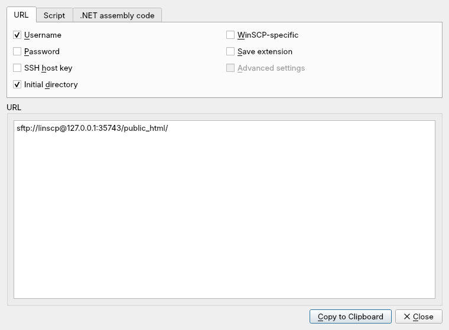

A session URL packs a whole connection into one string. You can type it into
the Site Manager's **Host name** box, paste it with **Paste Session URL**
(<kbd>Ctrl</kbd>+<kbd>V</kbd> in the tree), open it with
**Tabs › Sites › Open URL...**, pass it to `linscp` or `linscp-cli` on the
command line, or click it in a browser once linscp handles those links.

## Syntax

```
scheme://[user[:password][;fingerprint=key][;x-name=value]@]host[:port][/path/]
```

- **scheme** selects the protocol: `sftp`, `scp`, `ftp`, `ftps` (implicit
  TLS), `ftpes` (explicit TLS), `dav`, `davs`, `s3`, or `ssh` (opens SFTP).
  `http` and `https` mean WebDAV, except for known S3 endpoints.
- **user** and **password** are optional. Percent-encode reserved
  characters: `@` becomes `%40`, `:` becomes `%3A`, `;` becomes `%3B`.
- **fingerprint** pins the server's expected host key or TLS certificate
  fingerprint, so no prompt appears. See [Verifying host keys](../host-keys/).
- **x-name=value** sets any site setting by its raw name, as in
  [raw settings](../advanced-site-settings/#raw-settings).
- **host** can be a name or an address. Put IPv6 addresses in brackets:
  `[2001:db8::10]`.
- **path** is the remote directory to open. End it with `/`; without the slash
  the last part is treated as a file to download.

Examples:

```
sftp://alice@files.example.org/var/www/
ftpes://deploy@example.com:2121/
s3://AKIAEXAMPLE@s3.amazonaws.com/my-bucket/
sftp://alice;fingerprint=ssh-ed25519-255-AbCdEf0123@192.0.2.10/
```

Avoid putting passwords in URLs. They end up in shell history, process lists
and logs.

## Generate a URL from a site

Use **Commands › Generate Session URL/Code...** for the current session, or
**Generate Session URL/Code...** from the Site Manager's **Manage** menu for a
saved site. The **URL** tab builds the address; check what it should carry:
**Username**, **Password**, **SSH host key**, **Initial directory**, and
**Advanced settings** for settings that differ from the defaults. The other
tabs give the same connection as a script for `linscp-cli` or as code for the
.NET assembly. **Copy to Clipboard** takes the result.



## Opening links from a browser

The linscp desktop entry registers it for `sftp:`, `scp:`, `ftp:`, `ftps:`,
`ftpes:`, `dav:`, `davs:`, `s3:` and `ssh:` links, plus the `winscp-` forms of
these schemes. A link opened that way starts linscp with `/Unsafe`, which
marks the URL as coming from an untrusted source.

## What linscp ignores in untrusted URLs

A web page can hand you any link, so linscp drops the settings that could make
your computer run something. From an untrusted URL it ignores:

- the remote **Shell**, **Listing command** and **SFTP server**;
- the local proxy command and the Telnet proxy command;
- the remote recycle bin settings, FTP **Post login commands** and the
  **Return code variable**;
- permission for WebDAV redirects to other hosts or to plain HTTP.

The same run also refuses switches that would change your configuration, and
`linscp-cli` runs no script commands.

When you paste or type a URL whose `x-` settings include any of these, linscp
asks before using them. Answer **Cancel** unless you trust where the URL came
from.
