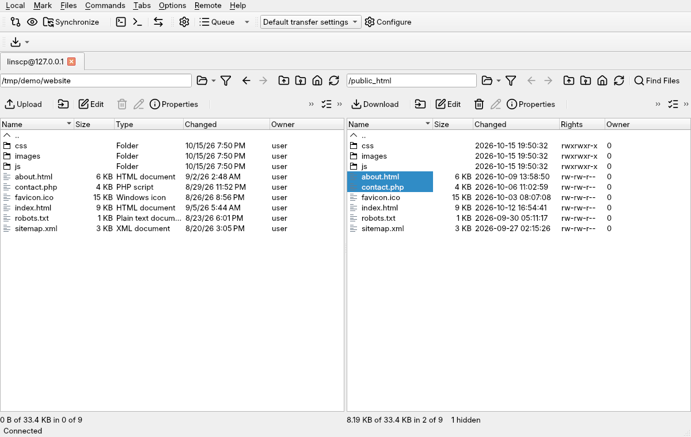
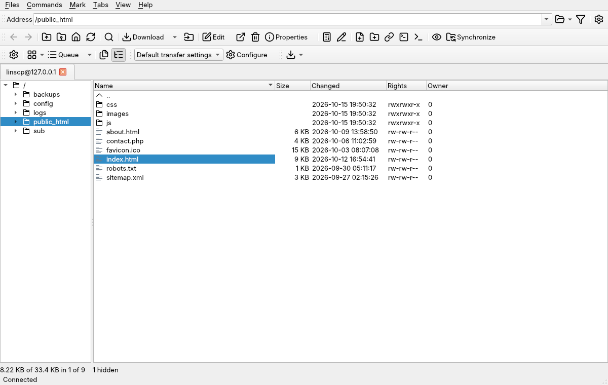

The main window comes in two layouts. **Commander** shows your computer and the
server side by side. **Explorer** shows only the server, with a folder tree,
much like a desktop file manager. Both offer the same commands; only the
arrangement and some keys differ.

## Choose a layout

Open **Options › Preferences**, go to **Environment › Interface**, and pick
**Commander** or **Explorer**. The change takes effect the next time you start
linscp. In the Explorer layout, **Preferences...** is in the **View** menu.

## Commander

From top to bottom:

- **Menu bar.** **Local** and **Remote** hold commands for the left and right
  panel. **Mark** selects files, **Files** acts on the selection, **Commands**
  holds tools such as synchronization, the console and find. **Tabs** manages
  sessions and sites, **Options** controls what the window shows, and **Help**
  links to the project pages.
- **Toolbars.** Shortcuts for common commands, the queue, and the transfer
  settings preset that new transfers use. Right-click a toolbar to show, hide
  or customize toolbars, or use **Options › Toolbars**.
- **Session tabs.** One tab per open connection. You can also open a local tab
  that browses two local folders. Use <kbd>Ctrl</kbd>+<kbd>Tab</kbd> to cycle
  through them.
- **The two panels.** Each panel has a path box, navigation buttons (back,
  forward, parent, root, home, refresh) and a row of file buttons such as
  **Upload** or **Download**, **Edit** and **Properties**. Below them is the
  file list. Click a column header to sort; right-click it to choose columns.
  The active panel is the one with the focus; <kbd>Tab</kbd> switches.
- **Status lines.** Under each panel: how much of the folder is selected, and
  how many files are hidden. The window's status bar at the very bottom shows
  the connection state.

The keys follow two-panel file managers such as Midnight Commander:
<kbd>F5</kbd> copies to the other panel, <kbd>F6</kbd> moves, <kbd>F4</kbd>
edits, <kbd>F9</kbd> shows properties, and <kbd>F10</kbd> quits. The
[keyboard shortcuts](../../reference/keyboard-shortcuts/) page lists them all.

## Explorer

The Explorer layout has an **Address** box at the top, toolbars below it, the
session tabs, then the remote folder tree on the left and the file list on the
right. Its menus are **Files**, **Commands**, **Mark**, **Tabs**, **View** and
**Help**. To move files between the server and your computer, drag them to or
from your file manager, or use **Download** and pick a local folder. Keys follow
desktop conventions, for example <kbd>F2</kbd> to rename.

## The queue

Transfers that run in the background appear in the queue list below the file
panels. Each row shows the operation, source, destination, progress and speed.
Right-click a row to suspend, resume, reorder or cancel it. By default the list
hides itself while it is empty; change that under **Options › Queue**. See
[queue and background transfers](../../transfers/queue/).

## The command line

**Options › Command Line** (<kbd>Ctrl</kbd>+<kbd>Shift</kbd>+<kbd>M</kbd>)
adds a single-line command box under the panels. On the remote side it sends
the command to the server's shell; on a local side it runs the command in that
folder. See [console and remote commands](../../files/console-and-remote-commands/).

## Themes and icons

With **Interface theme** set to **Automatic**, linscp follows your desktop's
light or dark style. Set it to **Light** or **Dark** on the **Interface** page
to fix it. The **Window** page, next to it, picks the icon set. For more on the
look, see [interface, window and panels](../../preferences/interface-and-panels/).
