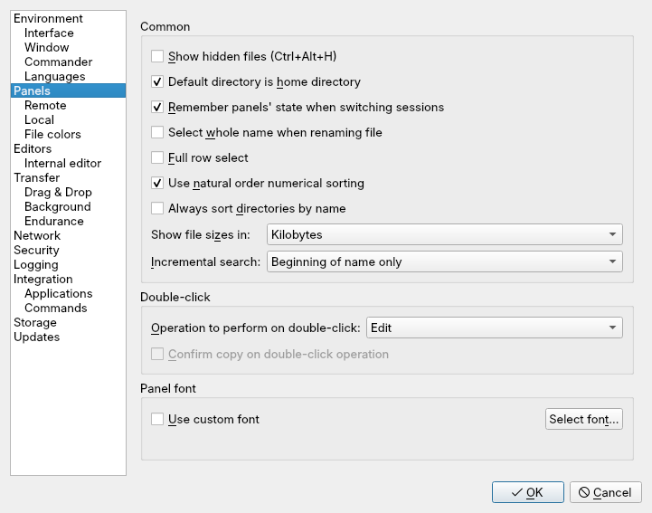

Program-wide settings live in one dialog. Open it with
**Options › Preferences...** or <kbd>Ctrl</kbd>+<kbd>Alt</kbd>+<kbd>P</kbd>.
The Site Manager's **Tools** menu has a **Preferences...** entry too, so you
can reach it before you connect.

Settings here apply to every session. Settings for one server belong in the
Site Manager; see [advanced site settings](../../connecting/advanced-site-settings/).

## Finding a setting

The tree on the left groups the pages. Type in the **Search** box above it to
list every setting whose label contains your text, then pick one to jump to
its page. Click **OK** to save your changes or **Cancel** to drop them.

## Page map

| Page | What you set there | Read more |
|---|---|---|
| **Environment** | Which actions ask for confirmation; beeps and notifications | |
| **Interface**, **Window**, **Commander**, **Explorer** | Layout, theme, window title, tabs, workspaces, compare criteria | [Interface and panels](../interface-and-panels/) |
| **Languages** | Interface language | below |
| **Panels**, **Remote**, **Local**, **File colors** | File list behaviour and colours | [Interface and panels](../interface-and-panels/) |
| **Editors**, **Internal editor** | Which editor opens which file | [Editors](../../editing/editors/) |
| **Transfer**, **Drag & Drop**, **Background** | Presets, drag behaviour, queue | [Transfer settings](../../transfers/transfer-settings/) |
| **Endurance**, **Network** | Resuming, reconnecting, active FTP | [Network and reconnection](../network-and-endurance/) |
| **Security** | Master password, authentication agent, host CAs | [Master password](../../security/master-password/) |
| **Logging** | Session and XML logs | [Logging](../logging/) |
| **Integration**, **Applications**, **Commands** | Desktop links, PuTTY or terminal, custom commands | [Linux desktop](../../integration/linux-desktop/) |
| **Storage** | Where settings and temporary files go | [Configuration storage](../storage-and-config/) |
| **Updates** | Update checks | below |

## Interface language

On **Environment › Languages**, pick a language from the list and click
**OK**. The change applies the next time you start linscp. A language shown
in grey has a translation file that failed to load.

**Get more...** opens linscp's translation notes on GitHub, which explain how
to add or improve a language. See also [translations](../../about/translations/).

## Update checks

linscp can look for a newer release on its GitHub Releases page. Nothing is
checked until you allow it.

On the **Updates** page:

- **Automatic check period**: **Never**, **Daily**, **Weekly** or **Monthly**.
- **Display information about update on startup** shows the result when
  linscp starts.
- **Check for beta versions**: **On** includes GitHub pre-releases, **Off**
  skips them. **Auto** includes them while linscp's version is below 1.0,
  which is the case for all current releases.
- **Connection**: no proxy, the system's proxy settings, or a proxy host and
  port that you enter. This proxy is used for update checks only.

To check once by hand, use **Help › Check for Updates**, or **Check for
Updates** in the Site Manager's **Tools** menu. linscp reports the result;
installing a new version is up to you.
